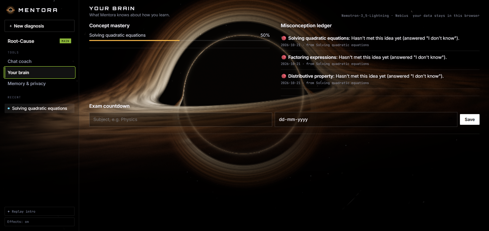
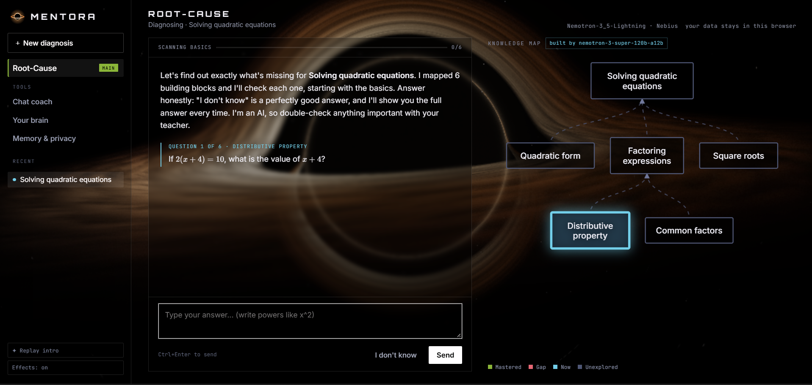
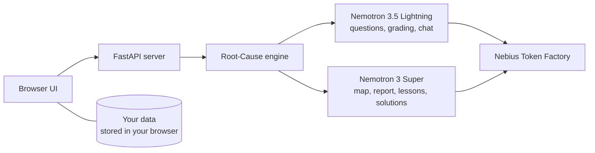

# Mentora: find the root cause, fix the gap

> A private AI study coach that doesn't just say "practise more". It traces a wrong answer back through the building blocks you're missing, teaches them from the bottom up, and checks later that they stuck.

Built for the **Nebius x NVIDIA Global AI Hackathon** (Personal AI track), running **NVIDIA Nemotron** on **Nebius Token Factory**.


## The problem

A student gets quadratic equations wrong, and every app says "do more quadratics". The real cause is often a missing building block from years ago, such as factorising, negative numbers or order of operations. A good tutor finds that. Most students can't afford one.

## What Mentora does

1. **Maps** the prerequisite concepts under anything you're stuck on, as a live knowledge map.
2. **Scans every building block**, foundations first. "I don't know" is a fine answer, and Mentora then shows the correct answer, why it's right, and how to get it.
3. **Finds the root cause** with a short report that names your specific misconception.
4. **Teaches from the bottom up.** Each gap gets a lesson with an analogy, a worked example and memory tricks, then check questions. There is an "Explain differently" button.
5. **Daily Review.** Fixed gaps return after 1, 3, 7 and 14 days (spaced repetition). If you forgot one, it turns red on your map again.
6. **Remembers you.** A misconception ledger, an exam countdown, and a chat coach that knows your open gaps.





## How it uses Nemotron on Nebius

| Step | Model | Why |
|---|---|---|
| Questions, grading, chat | Nemotron 3.5 Lightning | fast and cheap, with reasoning switched off for direct answers |
| Prerequisite map (structured JSON), root-cause report, lessons, full solutions | Nemotron 3 Super | stronger reasoning, with automatic fallback to Lightning |

- Called through Nebius Token Factory's OpenAI-compatible API.
- Streaming chat, and parallel calls (the full solution and the next question are generated at the same time).
- Structured JSON output for the knowledge map, with validation and retry.
- Grading safeguards: "I don't know" is detected in code and never graded as correct, and a verdict that contradicts its own explanation is overridden. When run locally, every grading decision is logged to a file so mistakes can be traced.



## Privacy by design

Each visitor's data lives in their own browser. The server is stateless: it processes each request and saves nothing, so every visitor gets a separate, private copy. You can view, download and delete your data on the Memory & privacy page.

## Honest limitations

- **AI can be wrong.** The questions, gradings and full solutions are written by an AI model and have not all been independently verified. Mentora tells students to double-check important answers with a teacher or textbook.
- **Tested on:** during development I tried it on quadratic equations (maths), projectile motion (physics), a chemistry preparation topic, and German question forming (languages). Maths topics with short, exact answers work best.
- **Data is tied to one browser.** Clearing browser data erases it, so use the Download button on the Memory & privacy page if you want a copy.
- **Demo tools:** the "Load sample progress" and "Demo: jump to tomorrow" buttons exist so Daily Review can be tried in seconds. A real review takes a day.

## Run it locally

```bash
git clone https://github.com/paulmelvin-dev/mentora.git
cd mentora
pip install -r requirements.txt
```

1. Get an API key from [Nebius Token Factory](https://tokenfactory.nebius.com).
2. Copy `.env.example` to `.env` and paste your key.
3. Run `python server.py` and open http://127.0.0.1:8000.

Tip: open `/?intro=1` to replay the opening sequence.

## Deploy

Designed to deploy on Vercel (FastAPI plus static files). Set the `NEBIUS_API_KEY` environment variable. Optionally set `MENTORA_ACCESS_CODE` to require an access code.

## Tech

Python, FastAPI, vanilla JavaScript and CSS, a WebGL shader for the black hole background, KaTeX for maths.

## Licence

MIT. See [LICENSE](LICENSE).